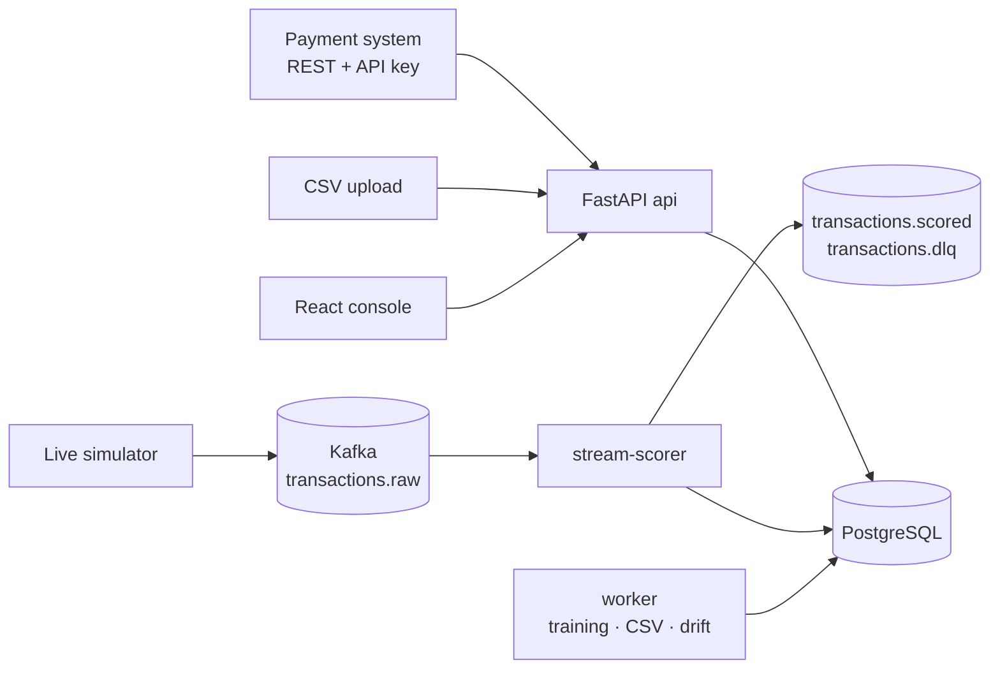

# Financial Fraud Detection Engine

Scores financial transactions for fraud risk in real time (REST API and a
Kafka stream), explains every score in plain language, and routes the riskiest activity to human
analysts through a case-management console. Analyst decisions become training labels for the next model.

> **All data is synthetic.** No real customer, card or banking information is used. The engine scores
> *transactions*, not people, and is **advisory only**: it returns `allow` or `review` and never declines
> a payment or blocks an account.

## The problem

Card and account fraud costs banks, payment companies and merchants enormous sums, and fraudsters change
tactics constantly. Rule-only systems ("block anything over $5,000") miss new patterns and bury analysts in
false alarms, while many machine-learning models are black boxes that analysts cannot question, and are
often tested in ways that overstate how well they really work.

## What this engine does

- Scores every transaction in real time as it happens, through a REST API or a Kafka stream.
- Explains each score in plain language ("6 purchases on this card in the last 10 minutes; usual is under 1") and shows which reasons came from the model and which from fixed rules.
- Sends only as many alerts as the analyst team can actually review each day, grouped into one case per card.
- Gives analysts an investigation console; their decisions become training data, and drift monitoring warns when fraud patterns change.
- Is advisory by design: it flags transactions for human review and never blocks a customer automatically.

**Who it is for:** fraud-operations teams at banks, fintechs and payment providers.

**Stack:** Python 3.13 · FastAPI · PostgreSQL 16 · Apache Kafka (KRaft) · scikit-learn · XGBoost · SHAP ·
React + TypeScript · Docker Compose · Terraform (AWS, not applied) · GitHub Actions

## Architecture



All three entry points (REST, CSV, Kafka) call **one scoring path**:
card's last 90 days → point-in-time features → calibrated XGBoost/LR probability + SHAP reasons +
anomaly score → deterministic rules (can only raise the band) → `allow`/`review` → one open case per card.

## Highlights

- **Leakage-safe ML.** Features only use the past (tested by deleting the future and checking nothing
  changes), labels are used only once *reported* (chargebacks arrive weeks later), and models are tested
  out-of-time. The evaluation report shows what a leaky setup would have claimed.
- **Training/serving parity.** Live scoring loads 90 days from PostgreSQL; training computes features in
  bulk. A test proves they produce identical numbers.
- **Thresholds from analyst capacity**, not an arbitrary 0.5: "flag about as many as the team can review".
- **Explanations analysts can read:** grouped SHAP ("6 earlier transactions on this card in 10 minutes"),
  always labelled *Model* or *Rule*.
- **Kafka done properly:** keyed by card (ordering), manual offset commits after the DB commit,
  idempotent writes (exactly-once effect), dead-letter topic, no dead-lettering during DB outages.
- **Investigation workflow:** claim → review → escalate → close with a decision; append-only notes,
  events and audit log (enforced by database triggers); every read of case detail is audited.
- **Privacy by design:** pseudonymous customers (no names/demographics), card tokens only (raw card
  numbers rejected, even in notes), keyed hashes for devices and payees.
- **Monitoring:** PSI drift on features and score; weekly precision/recall only on matured labels.

## Results

See [ml/reports/evaluation.md](ml/reports/evaluation.md) — every number there is produced by
`python -m app.cli evaluate` on simulated data (2,000 customers, one year, seed 42). They measure how
learnable the simulator is, **not** real-world performance.

Headline results (test period: 3 months after deployment, 244,190 transactions, 999 fraudulent):

| | Value |
|---|---|
| Production model | XGBoost (best cross-validated PR-AUC: 0.763 ± 0.063 vs. 0.682 random forest, 0.528 logistic regression) |
| Test PR-AUC / ROC-AUC | 0.709 / 0.981 (rules-only baseline: PR-AUC 0.039) |
| Reviewed (high + critical) | ~31 alerts/day · 27% precision · **77% of fraud transactions, 93% of fraud dollars** |
| Critical band | 5 alerts/day · 96% precision |
| Known scenarios (card testing, cloned card, stolen card, account takeover) | 96–100% recall |
| New, unseen pattern (`device_compromise`, drift) | 40% recall: the weak spot, and why drift monitoring exists (category-mix PSI 0.43 flags it) |
| What a random split would have claimed | PR-AUC 0.929 (vs. 0.709 measured honestly) |


## Run it

```bash
cp .env.example .env                      # fill in the CHANGE_ME values
docker compose up -d --build
docker compose run --rm api python -m app.cli demo
open http://localhost:8080                # analyst@example.com / lead@ / admin@ / auditor@ + FDE_ADMIN_PASSWORD
make stream                               # live synthetic traffic through Kafka
```

API docs: http://localhost:8000/api/docs. Score a transaction (create a key under Administration → API keys):

```bash
curl -X POST http://localhost:8000/api/v1/transactions -H "X-API-Key: $KEY" -H "Content-Type: application/json" -d '{
  "external_id": "TXN-1", "card_token": "tok_…", "merchant_ref": "M-ELECTRONICS-WEB-00", "amount": "899.00",
  "channel": "ecommerce", "entry_mode": "online", "occurred_at": "2026-11-01T12:00:00Z",
  "device_fingerprint": "abc", "ip_country": "FR"}'
```

## Documentation

| Doc | Contents |
|---|---|
| [docs/DESIGN.md](docs/DESIGN.md) | Requirements, architecture, Kafka design, data model, API, ML strategy, security, decisions and what changed |
| [docs/MODEL_CARD.md](docs/MODEL_CARD.md) | Intended use, data, metrics, limitations, responsible use |
| [ml/README.md](ml/README.md) | The simulator: behaviour, fraud scenarios, label delay and noise |
| [docs/DEVELOPMENT.md](docs/DEVELOPMENT.md) | Local setup, tests, code map, exercises |
| [docs/OPERATIONS.md](docs/OPERATIONS.md) | Runbook: demo, retraining, rollback, Kafka, incidents |
| [docs/AWS_DEPLOYMENT.md](docs/AWS_DEPLOYMENT.md) | Terraform, cost estimate, deploy and teardown (nothing deployed) |
| [docs/known-limitations.md](docs/known-limitations.md) | What this does not do |

