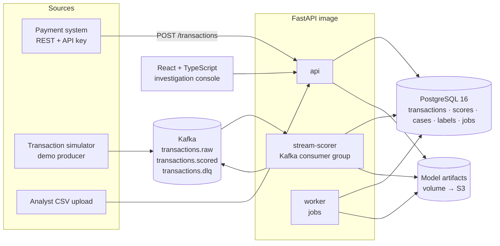
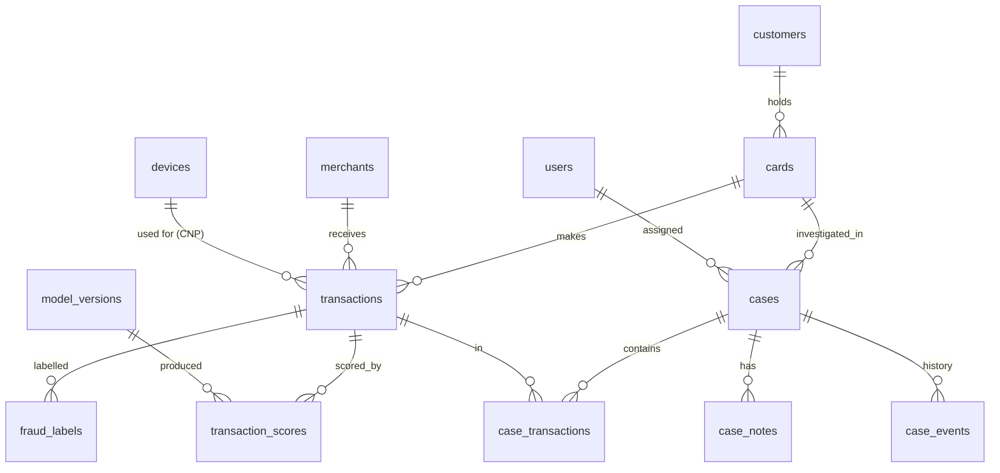

# Financial Fraud Detection Engine — Design Document (v1.0)

Status: **Implemented.** §10 lists where the implementation differs from this design, and why.

Contents
1. Product requirements
2. Architecture
3. Streaming design (Kafka)
4. Database design
5. API specification
6. Machine-learning strategy
7. Security, privacy and responsible-use design
8. Implementation roadmap
9. Key design decisions
10. Changes made during implementation

Reused from earlier, already-tested platforms: auth module (argon2 + JWT + rotating refresh tokens), PostgreSQL job queue, structured logging and RFC 9457 errors, CI workflow with gitleaks, Vite + React frontend scaffold, Terraform skeleton for ECS + RDS. Lessons from the AI Predictive Maintenance platform are applied up front (§6.9).

---

## 1. Product requirements

### 1.1 Problem
Card and account fraud costs issuers and merchants money, and catching it late means chargebacks, write-offs and unhappy customers. Pure rule systems ("amount > $5,000") are easy to evade and produce many false alarms. This engine scores every transaction for fraud **risk**, explains which signals drove the score, and routes the riskiest activity to human analysts. Analysts make the decisions; their decisions are fed back to improve the model.

### 1.2 Users and roles
| Role | Can do |
|---|---|
| **Admin** | Users and roles, thresholds and analyst capacity, rules, model training and activation, system configuration |
| **Lead analyst** | Everything an analyst can do, plus assign/reassign cases, close escalated cases, view team analytics |
| **Analyst** | Work cases assigned to them: review transactions and explanations, add notes, set disposition |
| **Auditor** | Read-only access to cases, decisions, model versions and the audit log; cannot change anything |

API clients (a payment system posting transactions) authenticate with **service API keys** scoped to `transactions:write`, not user accounts.

### 1.3 Functional requirements (MVP)
| ID | Requirement |
|---|---|
| F1 | Login, JWT sessions, role-based access (4 roles above); scoped API keys for machine clients |
| F2 | Transaction ingestion via REST (single + batch), CSV upload, and a Kafka stream |
| F3 | Validation: schema, currency/amount sanity, known card/merchant references, duplicate `external_id` rejected, card numbers must be tokens (Luhn-valid 13–19-digit strings are rejected as likely raw PANs) |
| F4 | Transaction storage and history: search and filter by card, customer, merchant, amount, channel, country, time, risk band, case status |
| F5 | Fraud **risk score** 0–1 (calibrated probability) per transaction, in real time |
| F6 | Risk band: low / medium / high / critical (admin-configurable thresholds) |
| F7 | Explanations: top contributing signals (SHAP), grouped and written in plain language ("7 purchases on this card in the last 10 minutes; usual is under 1") |
| F8 | Deterministic rules alongside the model (velocity, impossible travel, blocked merchants); rules and model output are labelled separately everywhere |
| F9 | Case management: high/critical transactions open a case **per card**; later flagged activity on that card attaches to the open case |
| F10 | Case workflow: open → in review → (escalated) → closed, with assignment, SLA timer, append-only notes, disposition (`confirmed_fraud`, `legitimate`, `inconclusive`) |
| F11 | Investigation view: the flagged transaction in context of the card's recent history, map of locations, devices, explanation, rules fired |
| F12 | Analytics and reports: flagged volume, case outcomes, precision of alerts by band, fraud loss prevented vs. missed (on synthetic data), CSV/PDF export |
| F13 | Admin: users, API keys, thresholds, analyst daily capacity, model registry (metrics, activate, roll back) |

### 1.4 Advanced requirements (post-MVP, in priority order)
A1 Real-time streaming with Kafka (end-to-end, with replay and dead-letter queue — designed in §3, built in M7) ·
A2 Behavioural anomaly score (unsupervised, catches patterns with no labels yet) ·
A3 Device and location risk indicators (new device, impossible travel, IP/home-country mismatch) ·
A4 Model performance monitoring on matured labels ·
A5 Drift detection (feature and score distribution) ·
A6 Analyst feedback loop into retraining ·
A7 Fraud trend analytics (by merchant category, channel, region, week).

### 1.5 Non-functional requirements
- Reproducible: `docker compose up` brings up Postgres, Kafka, api, worker, stream scorer and web with demo data.
- REST scoring latency < 100 ms p95 on a laptop (to be measured, not assumed).
- Stream throughput ≥ 500 transactions/second through one scorer instance (to be measured).
- Exactly-once *effect* per transaction (at-least-once delivery + idempotent writes).
- Every score is reproducible: stored with model version, feature values and rule versions.
- OpenAPI docs, structured JSON logs with request/trace IDs.

### 1.6 Out of scope (explicitly)
Real customer or banking data (never). Real card numbers (rejected by validation). Automated declines or account blocks. Identity/KYC verification. Multi-currency (USD only in MVP). Integration with real card networks.

---

## 2. Architecture

### 2.1 Decision: modular monolith, three processes from one image
Same pattern as the AI Predictive Maintenance and Intelligent Document AI platforms, plus a Kafka consumer:

| Process | Does |
|---|---|
| `api` | HTTP: auth, ingestion, synchronous scoring, cases, analytics, admin |
| `worker` | PostgreSQL job queue: CSV imports, bulk re-scoring, training, drift reports, label maturation |
| `stream-scorer` | Kafka consumer: reads `transactions.raw`, scores, writes results, publishes `transactions.scored` |

All three call the **same** `scoring` service. There is one code path for scoring, regardless of how the transaction arrived.

| Option | Pros | Cons |
|---|---|---|
| **Monolith + worker + stream consumer (recommended)** | One codebase, one scoring path, easy to debug; the consumer scales independently by adding instances (Kafka partitions) | Discipline needed on module boundaries |
| Microservices (ingest / features / scoring / cases) | Independent deploys | Network hops on the latency-critical path, distributed transactions between scoring and case creation. distributed serving belong in a dedicated inference platform |

### 2.2 Decision: Kafka for streaming, PostgreSQL queue for jobs
Kafka carries the **transaction stream**, which is high-volume, ordered per card, and replayable. Background **jobs** (training, CSV import, reports) stay in the PostgreSQL queue from the AI Predictive Maintenance platform: they are low-volume, need status in the UI, and should be transactional with the data they touch. Using Kafka for jobs, or Postgres for the stream, would each be the wrong tool.

### 2.3 Component diagram


### 2.4 Backend module layout
```
backend/app/
  core/            config, logging, security, errors           (shared core)
  db/              SQLAlchemy models, session, Alembic
  modules/
    auth/ users/   login, refresh, roles, API keys              (shared core, + API keys)
    reference/     customers, cards, merchants, devices
    ingestion/     validation, REST single/batch, CSV import
    features/      point-in-time feature computation — shared by training and scoring
    rules/         deterministic rules engine (versioned rule set)
    ml/            training, evaluation, calibration, registry, explainers, anomaly model
    scoring/       features → model + rules → score, band, explanation, persisted result
    streaming/     Kafka producer/consumer, DLQ, replay
    cases/         case creation, assignment, workflow, notes, SLA
    labels/        chargebacks, analyst dispositions, label maturation
    monitoring/    drift (PSI), matured-label performance, latency metrics
    analytics/     dashboards and reports
    jobs/          queue adapter, worker loop                    (shared core)
ml/                synthetic data generator, experiments, evaluation reports
frontend/          Vite + React + TS + TanStack Query + Recharts + Tailwind  (shared frontend scaffold)
```

### 2.5 Scoring flow (REST, synchronous)
```mermaid
sequenceDiagram
  participant P as Payment system
  participant API
  participant DB as PostgreSQL
  P->>API: POST /transactions (API key)
  API->>API: validate (schema, token not a PAN, refs exist)
  API->>DB: insert transaction (unique external_id)
  API->>DB: read card's recent history (indexed, last 24 h)
  API->>API: features → model → calibrate → SHAP → rules → band
  API->>DB: insert score; if high/critical open or extend card case
  API-->>P: 201 {risk_score, risk_band, recommended_action: "allow" | "review", reasons}
```
`recommended_action` is advisory. The engine never declines a payment or blocks an account itself (§7.4).

### 2.6 Key library choices
| Concern | Choice | Why |
|---|---|---|
| Web / ORM / validation | FastAPI, SQLAlchemy 2.0, Alembic, Pydantic v2 | Same as the AI Predictive Maintenance and Intelligent Document AI platforms |
| Kafka client | `confluent-kafka` (librdkafka) | Mature, fast, transactional/idempotent producer, wheels for Linux and Windows |
| Kafka broker (local) | Apache Kafka 3.x in KRaft mode, single node | No ZooKeeper; matches what MSK runs |
| ML | scikit-learn, `xgboost-cpu`, SHAP (verification in tests) | Lessons from the AI Predictive Maintenance platform |
| Anomaly (A2) | Isolation Forest; PyTorch autoencoder as a compared alternative | See decision 6 in §9 |
| Tests | pytest + testcontainers (Postgres **and** Kafka), Vitest, Playwright, Locust | Real broker in integration tests |

---

## 3. Streaming design (Kafka)

### 3.1 Topics
| Topic | Key | Partitions (local) | Retention | Content |
|---|---|---|---|---|
| `transactions.raw` | `card_id` | 6 | 7 days | Validated-shape transaction events |
| `transactions.scored` | `card_id` | 6 | 7 days | Score, band, reasons, model version — for downstream consumers |
| `transactions.dlq` | `card_id` | 1 | 30 days | Messages that failed validation or scoring after retries, with the error |

**Why key by card:** Kafka preserves order within a partition. All of one card's transactions go to the same partition, so they are scored in order, and velocity features ("purchases in the last 10 minutes") see the previous ones.

### 3.2 Delivery guarantees
- Producer: `enable.idempotence=true`, `acks=all`.
- Consumer: manual offset commit **after** the score is written to Postgres. If the scorer crashes mid-batch, messages are re-read (at-least-once).
- Idempotency: `transactions.external_id` is unique; scores are upserted on `(transaction_id, model_version_id)`. A replayed message changes nothing. Net effect is **exactly-once per transaction**, without Kafka transactions spanning Postgres (which is not possible).
- Poison messages: up to 3 attempts with backoff, then published to `transactions.dlq` with the error, and the offset is committed so one bad message cannot stall a partition.

### 3.3 Replay and backfill
Resetting the consumer group offset re-scores a time range, used after activating a new model. Because writes are idempotent per model version, replay produces new score rows without duplicating transactions.

### 3.4 Running without Kafka
Kafka is part of `docker compose`, but the app runs with `STREAMING_ENABLED=false` (REST + CSV only). Unit tests don't need a broker; streaming integration tests use a Kafka testcontainer.

---

## 4. Database design

### 4.1 ER diagram


### 4.2 Tables (abridged; full DDL in Alembic migrations)
| Table | Key columns | Notes |
|---|---|---|
| `users`, `refresh_tokens` | as in the AI Predictive Maintenance platform; role ENUM(admin, lead_analyst, analyst, auditor) | |
| `api_keys` | id, name, key_hash, scopes[], created_by, last_used_at, revoked_at | Only the hash is stored; shown once on creation |
| `customers` | id, external_ref (`CUST-000123`), home_country, home_lat, home_lon, created_at | **Pseudonymous**: no names, birth dates, gender, ethnicity or address lines |
| `cards` | id, customer_id, token UNIQUE, last4, network, issued_at, status | `token` is never a PAN (validated) |
| `merchants` | id, external_ref, name, mcc, country, lat, lon | |
| `devices` | id, fingerprint_hash UNIQUE, first_seen_at | Hashed fingerprint |
| `transactions` | id, external_id UNIQUE, card_id, merchant_id, device_id NULL, amount NUMERIC(14,2), currency, channel ENUM(pos, ecommerce, atm, transfer), entry_mode, ip_country NULL, lat NULL, lon NULL, occurred_at, received_at, source ENUM(api, csv, stream) | Range-partitioned by month on `occurred_at`; index `(card_id, occurred_at DESC)` for velocity features |
| `transaction_scores` | id, transaction_id, model_version_id, score, risk_band, anomaly_score NULL, rules_fired JSONB, explanation JSONB, features JSONB, rule_set_version, latency_ms, scored_at | UNIQUE(transaction_id, model_version_id). `features` stored so every score can be reproduced and audited |
| `fraud_labels` | id, transaction_id, label ENUM(fraud, legitimate), source ENUM(chargeback, analyst, customer_report, simulator_truth), reported_at, case_id NULL | **`reported_at` is what makes training leakage-safe** (§6.4) |
| `cases` | id, card_id, status ENUM(open, in_review, escalated, closed), priority, assignee_id NULL, disposition NULL, opened_at, sla_due_at, closed_at, closed_by | Partial unique index: one non-closed case per card |
| `case_transactions` | case_id, transaction_id, added_at | |
| `case_notes` | id, case_id, author_id, body, created_at | Append-only (no UPDATE/DELETE grants for the app role) |
| `case_events` | id, case_id, actor_id, event, from_status, to_status, details JSONB, ts | Full workflow history |
| `rules`, `rule_set_versions` | id, code, description, expression params JSONB, enabled; version, activated_at | Rules are data, versioned, not code edits |
| `model_versions` | as in the AI Predictive Maintenance platform, plus `threshold_config` JSONB, `reference_distribution` JSONB | Reference distribution feeds drift detection |
| `risk_settings` | band thresholds, analyst daily capacity | Admin-configurable |
| `drift_reports` | id, window_start, window_end, model_version_id, feature_psi JSONB, score_psi, status, created_at | |
| `ingestion_batches`, `jobs`, `audit_log` | as in the AI Predictive Maintenance platform; `audit_log` also records **reads** of case and transaction detail | Who looked at what is part of a fraud audit trail |

### 4.3 Data volume (demo)
~5,000 cards, ~600 merchants, 12 months, ~2 million transactions, fraud rate ~0.3–0.8% (realistic imbalance). About 1–2 GB with indexes.

---

## 5. API specification (v1)

All under `/api/v1`, JSON, RFC 9457 errors, cursor pagination.

| Method & path | Who | Purpose |
|---|---|---|
| `POST /auth/login` · `/auth/refresh` · `/auth/logout` · `GET /auth/me` | public / auth | as in the AI Predictive Maintenance platform |
| `GET/POST /users`, `PATCH /users/{id}` | admin | |
| `GET/POST /api-keys`, `DELETE /api-keys/{id}` | admin | key shown once |
| `POST /transactions` | API key `transactions:write` | ingest + score synchronously → 201 with score |
| `POST /transactions:batch` | API key | ≤ 1,000 → scored, per-item results |
| `POST /ingestion/csv` · `GET /ingestion/batches/{id}` | lead+ | async import + row-level report |
| `GET /transactions?card=&customer=&merchant=&band=&min_amount=&channel=&from=&to=` | analyst+ | search |
| `GET /transactions/{id}` | analyst+ | detail with score, explanation, rules, labels (read is audited) |
| `GET /cards/{id}/history?hours=72` | analyst+ | context timeline for the investigation view |
| `GET /cases?status=&assignee=me&priority=` | analyst+ | queue |
| `GET /cases/{id}` | analyst+ | full case (read is audited) |
| `POST /cases/{id}/assign` | lead+ | |
| `POST /cases/{id}/status` | assignee / lead | transitions validated by a state machine |
| `POST /cases/{id}/notes` | assignee / lead | append-only |
| `POST /cases/{id}/disposition` | assignee / lead | closes the case; writes `fraud_labels` (source = analyst) |
| `POST /labels/chargebacks` | API key `labels:write` | bulk chargeback feed |
| `GET /analytics/summary`, `/analytics/trends`, `/reports/{type}.csv` | lead+, auditor | |
| `GET /models` · `POST /models/train` · `POST /models/{id}/activate` · `POST /models/{id}/rollback` | admin | |
| `GET /monitoring/drift` · `/monitoring/performance` | lead+, admin | |
| `GET/PUT /settings/risk`, `GET/PUT /rules` | admin | |
| `GET /audit-log` | admin, auditor | |
| `GET /health/live` · `/health/ready` | public | ready = DB + model loaded (+ Kafka if enabled) |

Example scoring response:
```json
{
  "transaction_id": "7c1e…",
  "external_id": "TXN-2026-11-01-000981",
  "risk_score": 0.83,
  "risk_band": "critical",
  "recommended_action": "review",
  "model": {"name": "fraud-txn", "version": 4, "algorithm": "xgboost"},
  "reasons": [
    {"source": "model", "signal": "velocity", "contribution": 0.31,
     "text": "6 card-not-present purchases in the last 10 minutes (this card's usual: fewer than 1)"},
    {"source": "model", "signal": "device", "contribution": 0.18,
     "text": "First time this device has been used with this card"},
    {"source": "rule", "rule": "IMPOSSIBLE_TRAVEL", "version": 3,
     "text": "Previous transaction 2,140 km away, 25 minutes earlier"}
  ],
  "case_id": "c-41a…"
}
```

---

## 6. Machine-learning strategy

### 6.1 Synthetic data (never real banking data)
A seeded generator (`ml/synthetic/`) simulates customers, cards, merchants and devices, then a year of transactions.

Legitimate behaviour: each customer has a home location, spending categories, typical amounts (log-normal), daily/weekly rhythm, occasional travel, a small set of devices, and paydays.

Fraud scenarios, each with a distinct and realistic signature:
| Scenario | Signature |
|---|---|
| **Card testing** | Burst of tiny card-not-present authorisations at many merchants within minutes, then a large purchase |
| **Stolen card, card-not-present** | New device, IP country ≠ home, electronics/gift-card merchants, amounts above the customer's norm |
| **Account takeover** | Credentials/device change, then transfers to new payees |
| **Cloned card, card-present** | Physical transactions far from the customer's real location, sometimes "impossible travel" |
| **Compromised merchant** (advanced) | Cards used at one merchant later show fraud elsewhere |

Realism the model has to cope with:
- **Label delay:** fraud is discovered 1–60 days later (chargebacks), recorded as `reported_at`.
- **Label noise:** ~10% of fraud is never reported; some legitimate transactions are disputed.
- **Hard negatives:** real customers travel, buy electronics and change phones.
- **Concept drift:** a new fraud pattern appears in month 11, to test monitoring (§6.8).

Optional external check: PaySim (public synthetic mobile-money dataset) to show the pipeline works on data we didn't generate. Licence and citation documented. The popular "credit card fraud" Kaggle dataset is **not** used: its features are anonymous PCA components, so explanations would be meaningless.

### 6.2 Target
`y = 1` if the transaction is labelled fraud. Scoring happens at authorisation time, so only information available at that moment may be used.

### 6.3 Features (one `features` module for training and scoring)
| Family | Examples |
|---|---|
| Amount | amount, log amount, z-score vs. this card's last 90 days, ratio to card's max |
| Velocity | count and sum per card in last 10 min / 1 h / 24 h; distinct merchants in last 1 h; small-amount count in last 10 min |
| Time | hour of day vs. card's usual hours; seconds since previous transaction |
| Location | km from home; km/h implied speed since previous card-present transaction; IP country ≠ home |
| Device | new device for card; device age; cards seen on this device in last 24 h |
| Merchant | MCC group; merchant's historical fraud rate (**point-in-time**, only from labels reported before now, smoothed) |
| Account | card age; days since credential change; new payee (transfers) |

**Point-in-time correctness:** every feature uses only transactions strictly before the one being scored, and only labels with `reported_at` before scoring time. This is the most common source of fake accuracy in fraud models, and it gets its own tests.

Not used as features: anything resembling a protected attribute (none are stored), customer ID, or `transaction_id`.

### 6.4 Validation (time-based, leakage-safe)
- **Out-of-time split:** train on months 1–8, choose hyper-parameters and calibration on month 9, report on months 10–12. Fraud changes over time, so a random split overstates performance.
- **Label maturity:** training labels are only those reported by the end of the training window, which reproduces what would really have been known. Test labels use the full ground truth.
- **Grouped CV inside training** (by card) for model selection, so a card's transactions never sit on both sides of a fold.

### 6.5 Models compared
1. Rules-only baseline (velocity + amount + impossible travel), the bar to beat.
2. Logistic regression (scaled, class-weighted).
3. Random forest (balanced).
4. XGBoost (`scale_pos_weight`, early stopping).

Calibrated (isotonic or Platt, chosen on month 9). Imbalance is handled with class weights rather than SMOTE, because synthetic oversampling distorts calibrated probabilities. The comparison is reported either way.

### 6.6 Metrics (no numbers until we run them)
- **PR-AUC** (primary) and the precision-recall curve; ROC-AUC (secondary, it looks flattering on imbalanced data).
- Precision, recall and F1 at the operating threshold.
- **Recall at analyst capacity:** if analysts can review N cases/day, what share of fraud do the top-N catch? This is how fraud teams actually set thresholds.
- **Dollar-weighted recall:** share of fraud *amount* caught, because missing a $4,000 fraud is worse than missing a $4 one.
- Brier score and reliability plot.
- Per-scenario recall (card testing vs. ATO vs. …) to show where the model is weak.
- Written by `ml/evaluate.py` into `ml/reports/` with seed, data snapshot and git commit.

Stated in the README: results on synthetic data measure how learnable our simulator is, not real-world performance.

### 6.7 From score to action
- Bands from admin thresholds; defaults derived from the PR curve and analyst capacity, and documented.
- **low** → allow · **medium** → allow, visible in monitoring · **high / critical** → `review`: open or extend the card's case. Critical gets higher priority and a shorter SLA.
- Rules can raise a band (e.g., impossible travel → at least high), never lower it. Every reason is labelled `model` or `rule`.

### 6.8 Monitoring, drift and feedback (A4–A6)
- **Drift:** daily job computes PSI for the top features and the score distribution (last 7 days vs. training reference). PSI 0.1–0.25 = warning, > 0.25 = alert.
- **Performance:** PR-AUC and alert precision by week, computed only on transactions whose labels have matured (≥ 30 days old), with the delay stated in the UI.
- **Feedback:** analyst dispositions become labels (`source = analyst`) and are used in the next training run. Known bias, documented: only reviewed transactions get analyst labels, so the model can't learn from what it never flagged. Mitigation: a small random sample of low-band transactions is sent for review (configurable, default 0.1%).
- The month-11 drift scenario should trigger the drift alert in the demo, which is the end-to-end test of this feature.

### 6.9 Explainability, and lessons from the AI Predictive Maintenance platform
- SHAP via XGBoost `pred_contribs` / exact linear SHAP for LR, verified against the `shap` library in tests (the approach used in the AI Predictive Maintenance platform).
- **Grouped by signal family** (velocity, amount, device, location, …) so correlated features don't produce contradictory explanations.
- Sentence templates turn the top groups into analyst-readable text with the actual values.
- Watch for spurious features ("ambient temperature" in the AI Predictive Maintenance platform): the evaluation report includes global importance, and any feature that tracks calendar time rather than behaviour is removed.

### 6.10 Anomaly score (A2)
An unsupervised model trained on legitimate-looking history gives an `anomaly_score` that can surface new fraud patterns before labels exist. It is shown as a separate indicator, not merged into the risk score, and its value is measured on the month-11 drift scenario.

---

## 7. Security, privacy and responsible-use design

### 7.1 Authentication and authorisation
- Auth from the AI Predictive Maintenance platform (argon2id, 15-min JWT, rotating httpOnly refresh cookie, login rate limit, lockout).
- Scoped, hashed API keys for machine clients; revocable; `last_used_at` tracked.
- Object-level checks: analysts can modify only cases assigned to them; leads can modify any; auditors read only. Tested with a role × endpoint × ownership matrix.

### 7.2 Data protection
- Synthetic data only. Pseudonymous customers; no names or demographics stored.
- Card **tokens** plus last 4 digits only; Luhn-valid PAN-like values rejected at ingestion, and flagged if pasted into case notes.
- Device fingerprints hashed. IPs reduced to country.
- App DB role has no UPDATE/DELETE on `case_notes`, `case_events` or `audit_log`.
- Reads of case and transaction detail are audit-logged.
- Secrets from env locally, AWS Secrets Manager later; gitleaks in CI.

### 7.3 Kafka
Plaintext on the local Docker network only. On AWS: TLS + IAM auth (MSK). Consumers re-validate every message; never trust the producer.

### 7.4 Responsible use (from the project requirements)
- The system scores **transactions**, not people. UI and API language: "risk score", "flagged for review", "risk indicators". Never "fraudster" or "criminal".
- No automated adverse action: the engine returns `allow` or `review` only. Decisions are made by authorised analysts, recorded with their name and reasoning.
- Explanations and rules fired are always visible to the analyst, so they can disagree with the model.
- Model limitations and the synthetic-data caveat are on the model page and in `docs/MODEL_CARD.md`.

---

## 8. Implementation roadmap

Each milestone ends with passing tests and updated documentation.

| # | Milestone | Deliverables |
|---|---|---|
| M0 | Foundation | Repo layout, Docker Compose (Postgres, Kafka KRaft, api, worker, scorer, web), CI, pre-commit, `.env.example` |
| M1 | Core + auth | Reused core and auth; 4 roles; API keys; role matrix tests |
| M2 | Reference data + ingestion | Customers/cards/merchants/devices, transaction validation (incl. PAN rejection), REST single/batch, CSV import, partitioned table |
| M3 | Synthetic data | Generator with all scenarios, label delay/noise, drift month; documented parameters; exploration notebook |
| M4 | Features | Point-in-time feature module with leakage tests; latency measured |
| M5 | ML pipeline | Baseline rules, LR/RF/XGBoost, calibration, out-of-time evaluation report with **actual** results |
| M6 | Scoring + rules | Scoring service, versioned rules engine, grouped SHAP explanations, bands, REST scoring latency measured |
| M7 | Streaming | Kafka producer/consumer, ordering by card, idempotency, DLQ, replay, simulator producer; throughput measured |
| M8 | Cases | Case per card, state machine, assignment, SLA, notes, dispositions → labels, audit of reads |
| M9 | Frontend | Login, case queue, investigation view (timeline, map, explanation), transaction search, analytics, admin |
| M10 | Monitoring | Drift (PSI), matured-label performance, anomaly score, feedback retraining, analytics/reports |
| M11 | Hardening | Playwright E2E, Locust load test, failure simulations (broker down, DB down, poison message), security review, known limitations |
| M12 | AWS readiness | Terraform (ECS Fargate, RDS, S3, ALB, MSK Serverless or alternative), cost estimate, teardown. **Design only; nothing deployed without approval** |

---

## 9. Key design decisions

1. **Architecture:** modular monolith, deployed as `api` + `worker` + `stream-scorer` from one image (§2.1).
2. **Kafka for the transaction stream, PostgreSQL queue for jobs** (§2.2). Kafka runs locally in KRaft mode; app also runs with streaming disabled.
3. **Advisory only:** the engine returns `allow` / `review` and opens cases; it never declines payments or blocks accounts (§7.4). A real issuer would add a "hold" action, so tell me if you want that simulated.
4. **Synthetic data** from our own generator with five fraud scenarios, label delay/noise and a drift month (§6.1); PaySim as an optional external check; Kaggle PCA dataset not used.
5. **Validation:** out-of-time split (months 1–8 / 9 / 10–12) with label maturity, plus grouped CV by card (§6.4). Primary metric PR-AUC; thresholds set from **analyst capacity**.
6. **PyTorch:** your stack lists it. I recommend using it only for the A2 anomaly model (autoencoder compared against Isolation Forest), so the core engine doesn't need a ~200 MB dependency. Alternative: skip PyTorch entirely if Isolation Forest is enough.
7. **Roles:** admin, lead analyst, analyst, auditor, plus scoped API keys (§1.2).
8. **One open case per card** (not per transaction or per customer) (§4.2).
9. **USD only** in MVP.
10. **AWS streaming cost:** MSK Serverless costs roughly $540/month if left running, before traffic. For the AWS stage I'll propose either short-lived demo runs or swapping in Amazon Kinesis/SQS behind the same `streaming` interface. Decided at M12, nothing now.
11. **Frontend:** same Vite + React + TypeScript stack as the AI Predictive Maintenance and Intelligent Document AI platforms.

---

## 10. Changes made during implementation

| Area | Original design | What was built | Why |
|---|---|---|---|
| Transactions table | Range-partitioned by month | Plain table with indexes on (card, time), (merchant, time), time and band | Scores, labels and cases need foreign keys to transactions; PostgreSQL requires the partition key in every referencing key. Partitioning is already demonstrated in the AI Predictive Maintenance platform |
| Calibration | Isotonic or Platt, chosen on validation | **Platt (sigmoid)** | With a few hundred frauds in the calibration window, isotonic regression produced a staircase with large ties, which made band thresholds coarse |
| Splits | Months 1–8 train / 9 calibrate / 10–12 test | Deployment date D: train < D−60 days, calibrate D−60…D−30, gap D−30…D, test ≥ D | The 30-day gap keeps immature labels (fraud not yet reported) out of calibration. The same function trains the production model with D = latest data |
| Training sample | All rows | All frauds + 25% of legitimate rows (weighted ×4) | Keeps training fast; probabilities are re-calibrated on untouched data afterwards |
| Account takeover signal | Days since credential change | New device + new payee + IP mismatch | The ingestion schema has no account-event feed; documented in known limitations |
| Device/payee identifiers | Hashed | **Keyed** hash (HMAC-SHA256, `FDE_PSEUDONYM_SECRET`) | A plain SHA-256 of an account number can be reversed by guessing |
| Stored features | On every score | On medium-and-above scores | ~1 KB per score; low scores are reproducible by recomputation |
| History features | "Seen before" | "Seen in the last 90 days" | Every history feature has a fixed 90-day memory, so live scoring can load just 90 days and still match training exactly (tested) |
| PyTorch autoencoder (decision 6) | Optional comparison | Not built; Isolation Forest only | Isolation Forest is evaluated in the report; adding a ~200 MB dependency for a comparison was not worth it. Listed in known limitations |
| Streaming on AWS (decision 10) | Decide at M12 | Terraform does not provision MSK; streaming is disabled on AWS | Idle MSK costs ~$540/month. REST and CSV work on AWS; Kafka runs locally |
| Device age feature | Days since the device was first seen | Capped at 90 days | The first evaluation showed `device_age_days` with PSI ≈ 1.2 from the first test month: it grew with calendar time, a spurious trend (like the AI Predictive Maintenance platform's ambient temperature). Capping matches the 90-day memory of every other feature |
| Gitleaks in CI | `gitleaks-action` | gitleaks CLI over full history | The action fails on a repository's first push (root commit has no parent); same fix as in the AI Predictive Maintenance platform |
